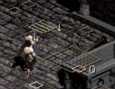
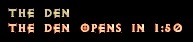
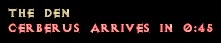
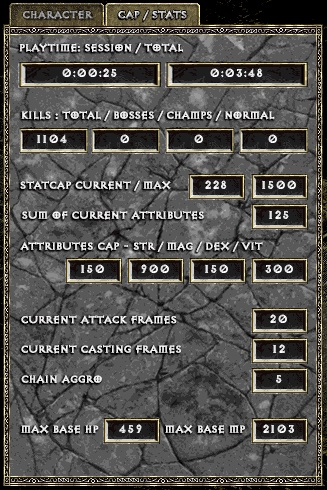
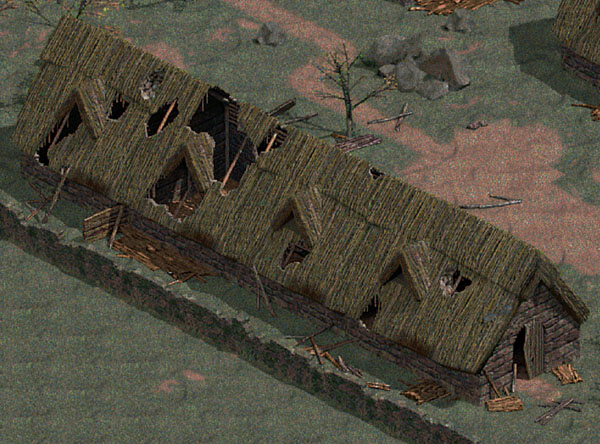

# Niko's submod

Submod for The Hell 4 based on source provided for v.744

## Installation

1. Grab latest version of submod from [releases](https://github.com/Nikodemsky/thmod/releases/latest)
2. Use your own copy of v0.744 or [download backup](https://drive.google.com/file/d/1p50lTU8JDtfFM8lgLKiXp9vUwr3V4ROT/view)
3. Unpack submod and put the .exe file in the root folder of the main mod (replace existing .exe file)

> [!IMPORTANT]
> Remember about DIABDAT.mpq from your own, genuine copy of Diablo.

## Features

### QOL's:

01. **Custom markings for Stairs/Entrances**

> [!NOTE]
> Enabled by default, disable by setting: `set StairLabels off`

02. **Full support for mouse scroll in the main menu**
03. **Added timer for The Den** (Rampaging demon quest)

  

04. **Added pedestal next to statues for Island of the Sunless sea**
* opens portal right away, 
* costs 99% current hp/mp and 5% of current level's xp

05. **Monster tracking on minimap** 
tracks aggroed monsters on the minimap, based on implementation of StArchon/Godroll

> [!NOTE]
> Disabled by default, enable by adding:
`set ShowBattleMarkers on`

06. **Custom Statistics / Caps panel**
* Available from character panel, with tabs or by hotkey "/"

### Mechanics:

01. **New GC for Hydramancer - Inquisitor's favour**; converts Acid element to holy one for hydras
02. **Redesigned synergies for hydramancer**
03. **New GC for Guardian - Siegemaster**, allows to summon Trapper and Bombardier minions [**WIP**]

### Custom functionalities

01. **Shared stash**

> [!NOTE]
> disabled by default, enable by adding:
`set SharedStash on` in the config

* available only for default single player mode (no Classic/Colosseum etc.)
* each new stash tab costs 3x more, than personal equivalent
* items, that could morph or would be incompatible with current character will simply be locked
* Access via "Open safe deposit box" option, Gillian

02. **Rich presence for Discord**

  

> [!NOTE]
> disabled by default, enable by adding:
`set DiscordRichPresence on` to the config file

03. **Linux compability layer for wine/proton**
* Works with `set DDraw off`
* Enabled by default, no need for additional configurations
* <ins>Incorporated into main mod, as of v0.811</ins>
* Tested on KDE/Xfce/Gnome/Cinnamon desktop enviroments

04. **Ravenholm revisited**
* Custom textures for buildings
* Fixed collision
* Added minimap rendering support
* <ins>Incorporated into main mod, as of v0.820</ins>

_________________

### TO DO's

- [ ] Come up with proper title for the submod
- [ ] Add image reference to custom functionalities in readme
- [ ] Show current debuffs as icons or text infos in UI
- [ ] Further works on Siegemaster (as of now, it's just baseline)
- [ ] Rebalance paladin (mostly hammers)
- [ ] Custom rule for normal mode, allowing to save everywhere (probably same implementation as in Antigrind submod, via GC)
- [ ] Allow uberbosses in SP (probably also through GC)
- [ ] Make Midas set actually fully obtainable

## Under Consideration

- [ ] Custom mechanics for Super Mutant GC
- [ ] Achievements
- [ ] Custom greetings for npc's
- [ ] Some custom works on Warlord
- [ ] Custom spells
- [ ] Some works on summoners, possibly synergies
- [ ] Custom ailments, starting with ignite based on fire damage
- [ ] Custom works on thief
- [ ] Custom, additional formula for XP; possibly based on dlvl
- [ ] High-level drops
- [ ] Custom works on Gladiatrix, possibly give better chance to drop sigils, in certain circumstances
- [ ] Custom works on Psion
- [ ] Custom sprites for characters, along with Blender template for easy batching for spritesheets
- [ ] Custom UI icons for vulnerabilities
- [ ] New biomes
- [ ] New monsters (with custom/unique sprites)
- [ ] Companion/Pet for picking up gold and possibly items
- [ ] Custom website for submod

 
and more.

## Finshed

- [x] ~~Show current statcap~~ done: [e9b2d92](https://github.com/Nikodemsky/thmod/commit/e9b2d92270f30c1819b36c111efd33823c990ab2) / [v0.06](https://github.com/Nikodemsky/thmod/releases/tag/v0.06)
- [x] ~~Further balance for new hydramancer's synergies~~ Mostly done
- [x] ~~Time counter, for ingame time spent on specific character (probably same implementation, as in for Godroll)~~ done: [e9b2d92](https://github.com/Nikodemsky/thmod/commit/e9b2d92270f30c1819b36c111efd33823c990ab2) / [v0.06](https://github.com/Nikodemsky/thmod/releases/tag/v0.06)
- [x] ~~New, custom tab with additional info, or stricly technical info for the current character~~ done: [e9b2d92](https://github.com/Nikodemsky/thmod/commit/e9b2d92270f30c1819b36c111efd33823c990ab2) / [v0.06](https://github.com/Nikodemsky/thmod/releases/tag/v0.06)
- [x] ~~Revamp house textures for Ravenholm~~ done: [pull-2](https://github.com/Nikodemsky/thmod/pull/2/changes) / [v0.07](https://github.com/Nikodemsky/thmod/releases/tag/v0.07)
- [x] ~~Fix collision for Ravenholm buildings~~ done: [4693d34](https://github.com/Nikodemsky/thmod/pull/4/changes/4693d34553dede3308488787e20208faf344263c) / [v0.07](https://github.com/Nikodemsky/thmod/releases/tag/v0.07)
- [x] ~~Add minimap rendering fix/support for Ravenholm~~ done: [pull-3](https://github.com/Nikodemsky/thmod/pull/3/changes) / [v0.07](https://github.com/Nikodemsky/thmod/releases/tag/v0.07)

_________________

### Roadmap

Currently on the scope:

1. Visualization of debuffs
2. Small changes - ubers in SP, custom rule for normal mode, Midas set
3. Siegemaster

\+ sometime in the future, update mod base along with newly provided source (for now latest is v.744).